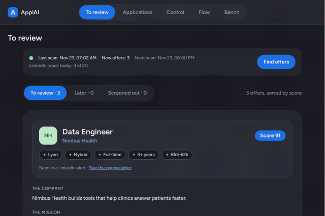

  
  
  

Studying at Ecole 42 (Data & AI). I like taking a project end to end, from the first talk with users to production, then watching how people use it to make it better.

## What I'm building

<table>
  <tr>
    <td width="50%" valign="top">
      
      <h3><a href="https://github.com/edaubert42/trustyfile">TrustyFile</a> · <a href="https://www.trustyfile.com">trustyfile.com</a></h3>
      Detects tampered invoices with 14 forensic modules and one trust score. In production, 1,400+ visits a month.
    </td>
    <td width="50%" valign="top">
      
      <h3><a href="https://github.com/edaubert42/applai">ApplAI</a></h3>
      Agents prepare job applications, each scored on an evaluation bench; a human approves every send. 50+ merged pull requests, most opened by agents.
    </td>
  </tr>
</table>

## Before

- **CybelAngel**, AI engineering intern: LLM alert triage for analysts, about 70% of alerts dismissed automatically, and a prompt evaluation loop.
- **Motorcycle school**, partner and director: 9,000+ students a year, €2.8M revenue, about 15 staff.

## Stack

**AI / LLM**  
  

**Backend & data**  

**Ship & ops**  

**Also (Ecole 42)**  

