  
  
  

Studying at École 42 (Data & AI). I like taking a project end to end, from the first talk with users to production, then watching how people use it to make it better.

## What I'm building

### [TrustyFile](https://github.com/edaubert42/trustyfile) · [trustyfile.com](https://www.trustyfile.com)

Detects tampered invoices and documents: 14 forensic modules feed one trust score, with the evidence boxed on the page. In production, 1,400+ visits a month.

### [ApplAI](https://github.com/edaubert42/applai)

Agents that prepare job applications while the candidate stays in control. Every agent is scored on an evaluation bench, and a human approves every send. Built from issues by coding agents in GitHub Actions; I review and merge every pull request.

## Before

- **CybelAngel**, AI engineering intern: LLM alert triage for analysts, about 70% of alerts dismissed automatically, and a prompt evaluation loop.
- **Motorcycle school**, partner and director: 9,000+ students a year, €2.8M revenue, about 15 staff.

## Stack

 
